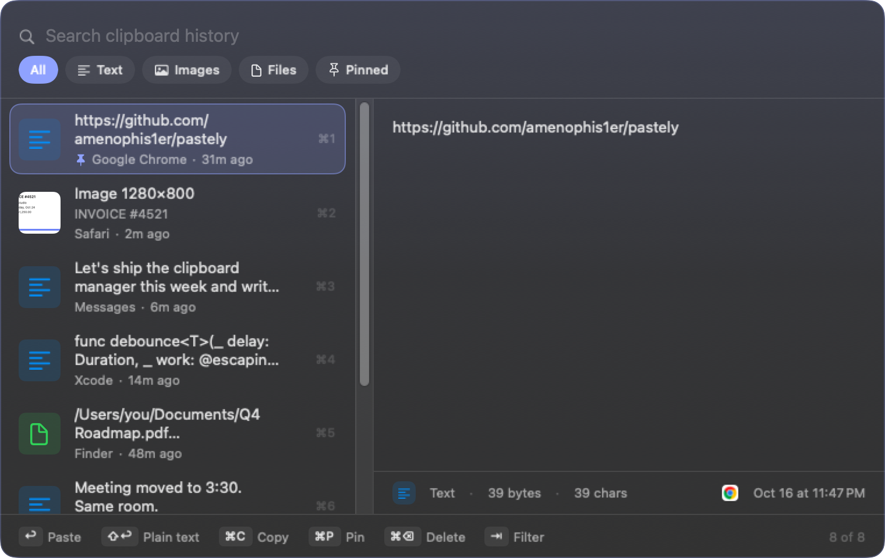
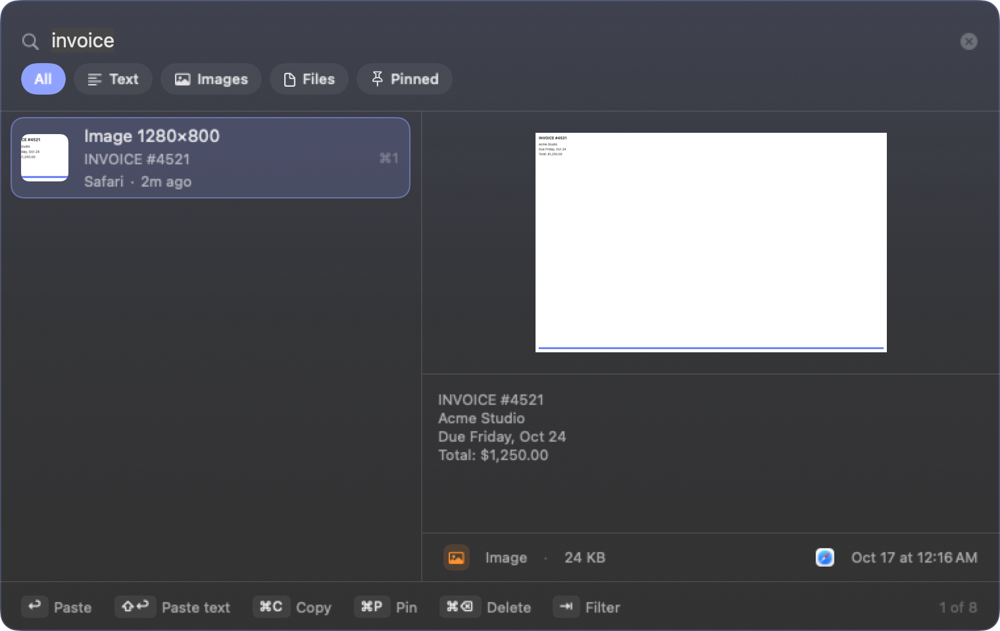

# Pastely

**Everything you copy, one keystroke away.** A light, local-only clipboard manager for macOS.

Website: [pastely.amenophis.dev](https://pastely.amenophis.dev) · Download: [latest release](https://github.com/amenophis1er/pastely/releases/latest)



## What it does

- Press **⇧⌘V** in any app. The panel opens next to your cursor. Type to search, Return to paste.
- Keeps text, rich text, images and file references.
- Reads the text inside screenshots on-device, so a search for "invoice" finds the picture. Shift+Return pastes the recognized text.
- Filters for text, images, files and pinned items. Pins survive cleanup.
- Updates itself through Sparkle from GitHub Releases.



## Privacy

A clipboard manager sees everything you copy, so Pastely is built to keep it to itself. Details in [SECURITY.md](SECURITY.md).

- History is encrypted on disk with AES-GCM. The key lives in your login keychain.
- Copies flagged as concealed by password managers are never recorded. Any app can be added to the ignore list.
- No analytics, no accounts, no sync. The only network request is the update check, which you can turn off.
- History expires by count, by age, or with one click.

## Install

Download the DMG from [Releases](https://github.com/amenophis1er/pastely/releases/latest), open it and drag Pastely to Applications. The app is signed with a Developer ID and notarized by Apple. Requires macOS 15 or later on Apple silicon.

On first launch a welcome screen walks you through the shortcut, the Accessibility permission (needed to paste into the app you are in) and launch at login.

## Keyboard

| Key | Action |
| --- | --- |
| ⇧⌘V | Open or close the history (change it in Settings) |
| Type | Fuzzy search, including text recognized in images |
| ↑ ↓ | Move selection |
| ↩ | Paste |
| ⇧↩ | Paste as plain text, or the recognized text of an image |
| ⌘1 … ⌘9 | Paste the nth visible item |
| ⌘C | Copy without pasting |
| ⌘P | Pin or unpin |
| ⌘⌫ | Delete |
| ⇥ | Cycle filters |
| ⎋ | Close |

URL scheme for launchers and scripts: `pastely://history`, `pastely://settings`, `pastely://pause`, `pastely://resume`, `pastely://welcome`.

## Build from source

Requires Xcode 27 on macOS 26. No third-party dependencies apart from Sparkle, pulled in by Swift Package Manager.

```sh
swift build && swift test
./scripts/bundle.sh && open build.noindex/dev/Pastely.app
```

The dev bundle is `Pastely Dev` with bundle id `com.amenophis.pastely.dev`. It has its own preferences, Accessibility entry, keychain key, history folder and `pastely-dev://` scheme, so it runs beside the installed release without touching it, and it has no update feed.

| Path | What |
| --- | --- |
| `Sources/Pastely/PasteboardWatcher.swift` | Capture and privacy filters |
| `Sources/Pastely/ClipStore.swift` | SQLite history, encrypted payloads, retention |
| `Sources/Pastely/HistoryPanel.swift` | Floating panel, filters, list, preview |
| `Sources/Pastely/FocusLocator.swift` | Finds the caret to place the panel |
| `Sources/Pastely/ImageTextRecognizer.swift` | On-device OCR through Vision |
| `Sources/Pastely/SettingsView.swift`, `WelcomeWindow.swift` | Settings and first launch |
| `Sources/Pastely/DesignSystem.swift` | Theme tokens and shared components |
| `scripts/make-icon.swift` | Regenerates the app icon |
| `Makefile` | `release`, `notarize`, `dmg`, `appcast`, `screenshots` |

## Release

Tag a commit and push it. CI builds, signs, notarizes, packages the DMG, signs it for Sparkle and publishes a GitHub Release with the appcast.

```sh
git tag v0.1.0 && git push origin v0.1.0
```

Locally, `make dmg` does the same with your Developer ID certificate and the `pastely-notary` keychain profile. Keychain access is remembered per code identity, which is why the bundle script signs with a stable identity rather than ad-hoc.

## License

MIT. See [LICENSE](LICENSE).
